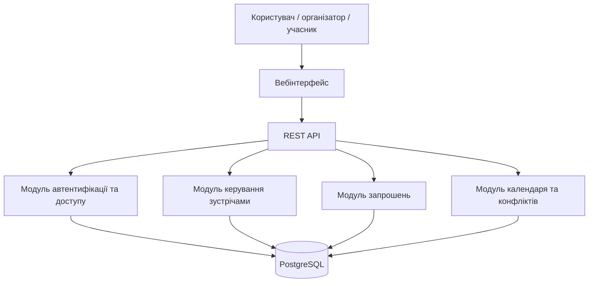
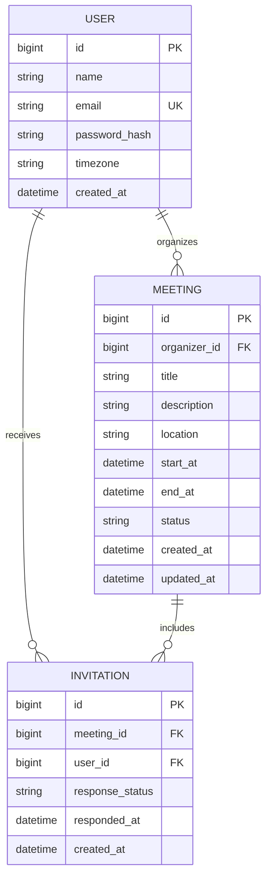
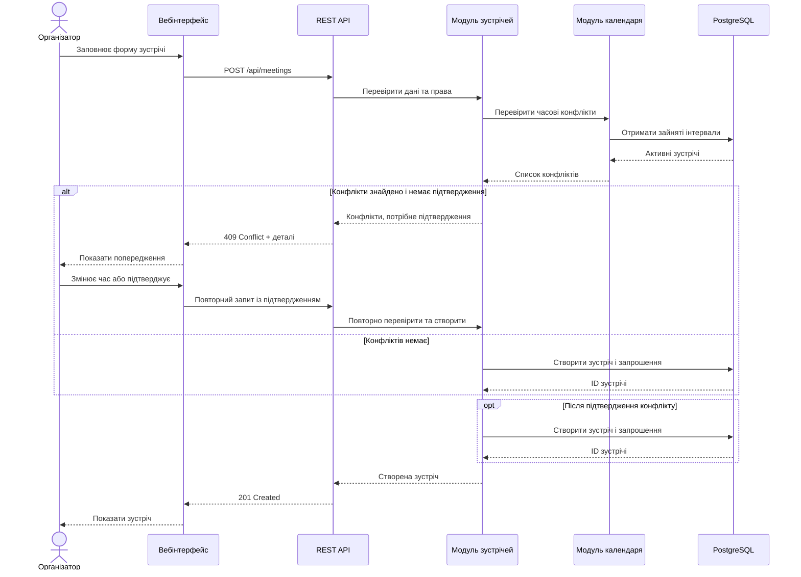
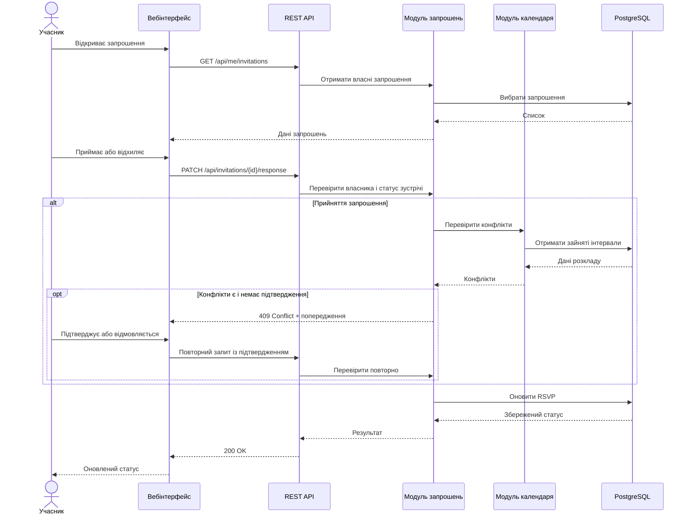
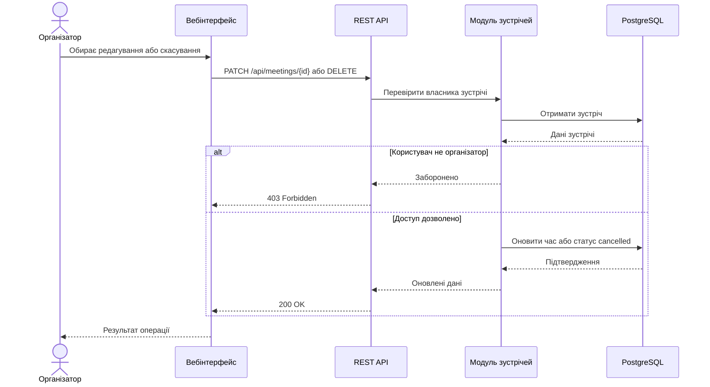
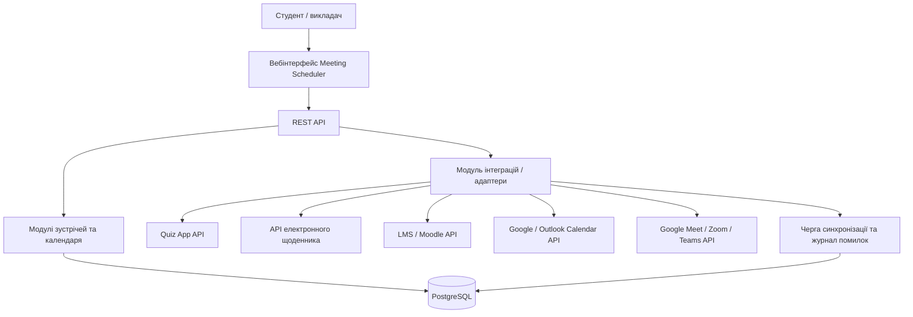
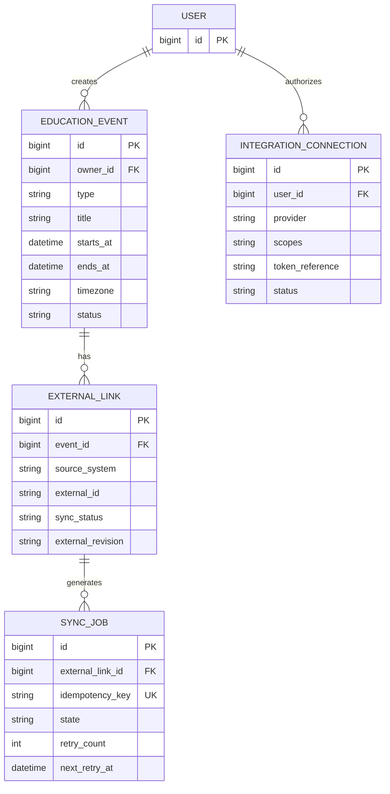
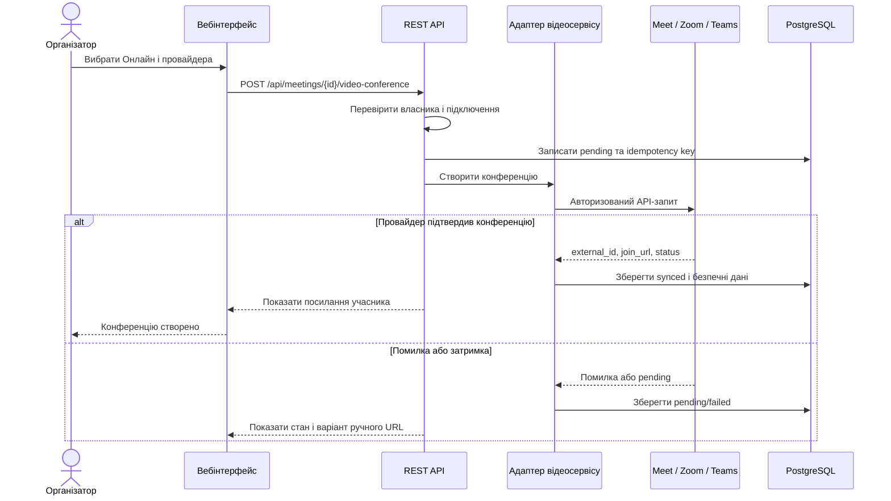

# SDD: Система обліку зустрічей (Meeting Scheduler)

## 1. Огляд і глосарій

Meeting Scheduler — вебзастосунок для планування, обліку та керування зустрічами. Зареєстровані користувачі створюють зустрічі, запрошують учасників, узгоджують участь і переглядають особистий календар. Система попереджає про перетини в розкладі та зберігає історію зустрічей.

**Межі першої версії (MVP):** автентифікація, CRUD зустрічей, запрошення, RSVP, виявлення часових конфліктів, календарний список та історія.

**Поза межами першої версії:** інтеграції із зовнішніми календарями, Quiz App та електронним щоденником, автоматичний підбір вільного часу, повторювані події, email/push-нагадування та бронювання кімнат. Можливість перетворення на центр освітнього планування розглядається в розділі 9 як наступний етап.

### Глосарій

| Термін | Значення в документі |
|---|---|
| Користувач | Зареєстрована особа, яка створює зустрічі або отримує запрошення. |
| Організатор | Користувач, який створив конкретну зустріч та керує нею. |
| Учасник | Користувач, запрошений на зустріч. |
| Зустріч | Подія з назвою, часовим інтервалом, організатором та необов'язковим описом/місцем. |
| Запрошення | Зв'язок між зустріччю та запрошеним користувачем із його відповіддю. |
| RSVP | Відповідь учасника: очікує, прийнято або відхилено. |
| Конфлікт часу | Перетин інтервалів двох активних зустрічей у календарі користувача. |
| Календар | Впорядкований перелік зустрічей користувача за датами. |
| Історія | Минулі та скасовані зустрічі, доступні користувачеві. |
| Навчальна подія (майбутня) | Заняття, тест, дедлайн або іспит із часовими межами та посиланням на зовнішню систему. |
| Часове вікно тесту (майбутнє) | Інтервал, у якому Quiz App сам дозволяє початок/завершення тестування згідно з правилами. |
| Інтеграційний адаптер (майбутній) | Компонент обміну даними між Meeting Scheduler і окремим сервісом через захищений API. |
| Онлайн-конференція | Відеозустріч у зовнішньому провайдері (Google Meet, Zoom або Teams), пов’язана з подією планувальника. |
| Посилання учасника (`join_url`) | URL для приєднання до відеозустрічі; не тотожний організаторському посиланню або ключам доступу. |

## 2. Функціональні вимоги

User stories сформульовані у форматі «Як <роль>, я хочу <дія>, щоб <цінність>» та пріоритезовані за MoSCoW: Must, Should, Could, Won't.

| ID | User story | Пріоритет |
|---|---|---|
| US-1 | Як користувач, я хочу зареєструватися та увійти в систему, щоб безпечно працювати зі своїм розкладом. | Must |
| US-2 | Як організатор, я хочу створювати, редагувати та скасовувати зустрічі, щоб керувати запланованими подіями. | Must |
| US-3 | Як організатор, я хочу запрошувати зареєстрованих користувачів на зустріч, щоб узгоджувати участь. | Must |
| US-4 | Як учасник, я хочу приймати або відхиляти запрошення, щоб повідомляти організатора про свою участь. | Must |
| US-5 | Як користувач, я хочу бачити попередження про перетини часу, щоб уникати накладок у розкладі. | Should |
| US-6 | Як користувач, я хочу переглядати свої зустрічі за датою та статусом, щоб планувати день і тиждень. | Should |
| US-7 | Як користувач, я хочу переглядати історію минулих зустрічей, щоб відстежувати проведені події. | Should |
| US-8 | Як організатор, я хочу бачити статуси відповідей запрошених, щоб знати, хто планує прийти. | Should |
| US-9 | Як користувач, я хочу отримувати нагадування про зустріч, щоб не пропускати її початок. | Could |
| US-10 | Як організатор, я хочу створювати повторювані зустрічі, щоб не додавати регулярні події вручну. | Won't |

**Вимоги майбутніх інтеграцій (не входять до MVP):**

| ID | User story | Пріоритет |
|---|---|---|
| US-11 | Як викладач, я хочу прив'язати тест Quiz App до календарної події та встановити час відкриття і закриття, щоб студенти проходили контрольну у визначений період. | Won't (MVP) |
| US-12 | Як студент, я хочу бачити в одному календарі заняття, дедлайни й заплановані тести з електронного щоденника, щоб планувати навчальний час. | Won't (MVP) |
| US-13 | Як викладач, я хочу синхронізувати навчальні події з журналом або LMS, щоб не вводити розклад двічі. | Won't (MVP) |
| US-14 | Як користувач, я хочу синхронізувати події з зовнішнім календарем і сервісами відеозустрічей, щоб не пропускати події та швидко приєднуватися. | Won't (MVP) |
| US-15 | Як організатор, я хочу обирати Google Meet, Zoom або Teams і автоматично отримувати посилання після підключення акаунта, щоб швидко проводити навчальні, особисті та бізнес-зустрічі. | Won't (MVP) |
| US-16 | Як учасник, я хочу відкривати безпечне посилання на відеозустріч безпосередньо з календаря, щоб приєднуватися до неї вчасно. | Won't (MVP) |
| US-17 | Як організатор, я хочу, щоб перенесення чи скасування онлайн-події синхронізувалося з провайдером відеоконференцій, щоб учасники не користувалися застарілими запрошеннями. | Won't (MVP) |

Позначка `Won't (MVP)` означає **свідомо відкладено на наступний реліз**, а не остаточно відкинуто. Must-вимоги першої версії залишаються без змін.

**Правила MVP:** організатор має право редагувати й скасовувати лише свої зустрічі; учасник змінює лише власний RSVP. Конфлікт — це попередження, а не автоматична заборона створення зустрічі. До особистого зайнятого часу зараховуються власні активні зустрічі та прийняті запрошення; запрошення зі статусом `pending` не блокують час. Часовий інтервал визначається як `[start_at, end_at)`, тому зустрічі, що стикаються кінцями, не конфліктують. Скасовані зустрічі не блокують час.

## 3. Нефункціональні вимоги

Наведені показники — цільові критерії приймання, а не виміряні результати.

| ID | Категорія | Вимога (з метрикою) |
|---|---|---|
| NFR-1 | Продуктивність | 95% типових запитів на отримання списку зустрічей і запрошень виконуються менш ніж за 200 мс за навантаження до 100 одночасних користувачів. |
| NFR-2 | Масштабованість | Підтримка не менше 100 одночасних користувачів та зберігання щонайменше 10 000 зустрічей. |
| NFR-3 | Доступність | Цільовий uptime ≥ 99% за місяць; планові роботи оголошуються за 24 години. |
| NFR-4 | Безпека | Паролі зберігаються як стійкі криптографічні хеші; усі захищені маршрути перевіряють автентифікацію та власника ресурсу. |
| NFR-5 | Цілісність | RSVP та зміни зустрічей записуються транзакційно; повторне однакове RSVP не створює дубльованого запрошення. |
| NFR-6 | Сумісність | Підтримуються актуальні версії Chrome, Firefox та Edge. |
| NFR-7 | Тестованість | Покриття тестами бізнес-логіки зустрічей, RSVP і конфліктів становить не менше 80% рядків. |
| NFR-8 | Часові зони | Час зберігається у UTC (`timestamptz`), а користувачу показується в обраній часовій зоні; `end_at > start_at`. |

## 4. Архітектура

Система реалізується як вебзастосунок із REST API та реляційною БД. **Модульний моноліт** спрощує розробку MVP, але зберігає розділення відповідальностей.

**Компоненти:** вебінтерфейс (форми, календар, запрошення); REST API (маршрути та валідація); модуль автентифікації (облікові записи та доступ); модуль зустрічей (CRUD і статуси); модуль запрошень (RSVP); модуль календаря й конфліктів (вибірка та перевірка перетинів); PostgreSQL (збереження даних).



## 5. Модель даних

Один користувач може організувати багато зустрічей. Одна зустріч може мати багато запрошень, але для однієї пари `(meeting_id, user_id)` існує не більше одного запрошення. Організатор не дублюється в таблиці запрошень. Для MVP історія формується з поточних і минулих зустрічей; повний аудит усіх змін є майбутнім розширенням.



**Обмеження БД:** `USER.email` унікальний; `INVITATION(meeting_id, user_id)` унікальний; `MEETING.end_at > MEETING.start_at`; `MEETING.status ∈ {scheduled, cancelled}`; `INVITATION.response_status ∈ {pending, accepted, declined}`. Для прискорення пошуку рекомендовані індекси `MEETING(organizer_id, start_at)` та `INVITATION(user_id, response_status)`. Перевірка конфліктів виконується для інтервалів, де `existing.start_at < proposed.end_at AND existing.end_at > proposed.start_at`.

## 6. Ключові сценарії

### 6.1. Створення зустрічі та перевірка конфліктів

Організатор вводить дані зустрічі та список учасників. Система перевіряє час, права доступу, наявність користувачів та накладки. Якщо конфлікт знайдено, система показує попередження й дозволяє змінити час або підтвердити створення попри конфлікт.



### 6.2. Відповідь на запрошення

Учасник відкриває запрошення й обирає відповідь. Система перевіряє, що запрошення належить саме цьому користувачеві та зустріч не скасована. Під час прийняття система попереджає про конфлікт часу; після підтвердження зберігає RSVP.



### 6.3. Перенесення або скасування зустрічі



## 7. Ескіз API

| Метод | Шлях | Призначення | Доступ |
|---|---|---|---|
| POST | `/api/auth/register` | Реєстрація користувача | Гість |
| POST | `/api/auth/login` | Вхід у систему | Гість |
| GET | `/api/meetings` | Список власних і прийнятих зустрічей; фільтри дат | Авторизований |
| GET | `/api/meetings/{id}` | Деталі доступної зустрічі | Організатор або запрошений |
| POST | `/api/meetings` | Створити зустріч із запрошеннями | Авторизований |
| PATCH | `/api/meetings/{id}` | Редагувати зустріч | Організатор |
| DELETE | `/api/meetings/{id}` | Логічно скасувати зустріч (`cancelled`) | Організатор |
| GET | `/api/me/invitations` | Отримати власні запрошення | Авторизований |
| PATCH | `/api/invitations/{id}/response` | Прийняти або відхилити запрошення | Адресат запрошення |
| GET | `/api/me/calendar` | Календар зустрічей за період | Авторизований |
| GET | `/api/me/meetings/history` | Історія минулих і скасованих зустрічей | Авторизований |
| POST | `/api/meetings/check-conflicts` | Попередня перевірка перетинів часу | Авторизований |

**Приклад запиту на створення:**

```json
{
  "title": "Обговорення курсового проєкту",
  "description": "Проміжний огляд результатів",
  "location": "Аудиторія 204",
  "start_at": "2026-11-12T12:00:00Z",
  "end_at": "2026-11-12T13:00:00Z",
  "invitee_ids": [2, 3],
  "confirm_conflicts": false
}
```

**Контракт помилок:** `400` — некоректний інтервал або дані; `401` — немає автентифікації; `403` — немає прав; `404` — ресурс не знайдено; `409` — конфлікт часу без підтвердження. Під час повторного запиту з `confirm_conflicts: true` сервер повторно перевіряє стан розкладу. Повторне прийняття вже прийнятого запрошення не створює дубльованих записів.

## 8. Ризики та альтернативи

### Ризики

| Ризик | Імовірність | Вплив | Як пом'якшуємо |
|---|---|---|---|
| Перетин зустрічей у розкладі | Висока | Середній: користувач не може бути на двох подіях одночасно | Перевірка інтервалів, попередження, повторна перевірка перед збереженням. |
| Некоректна робота з часовими зонами | Середня | Високий: зустріч відображається не в той час | Зберігати UTC, показувати час у часовій зоні користувача, тестувати перехід на літній/зимовий час. |
| Несанкціонована зміна чужої зустрічі | Середня | Високий: порушення цілісності та приватності | Серверна перевірка організатора і адресата запрошення для кожної операції. |
| Подвійне оновлення при одночасних запитах | Середня | Середній: неузгоджений статус RSVP або зустрічі | Транзакції, обмеження унікальності, контроль конкурентних змін. |
| Недоступність сервера чи БД | Середня | Високий: користувачі не бачать розклад | Резервні копії, моніторинг, перевірка відновлення. |
| Конкуренція з великими календарними сервісами | Висока | Середній: складно залучати користувачів | Фокус на простому обліку навчальних і командних зустрічей та швидкому MVP. |

### Розглянуті альтернативи

- **Мікросервіси замість модульного моноліту:** відхилено для MVP через складніші розгортання й підтримку.
- **Зберігання зустрічей лише в браузері:** відхилено, бо користувачам потрібен спільний розклад і доступ із різних пристроїв.
- **Автоматична заборона всіх конфліктів:** відхилено; інколи користувач має свідомо погодитися на перетин, тому система попереджає й вимагає підтвердження.
- **Повна інтеграція з Google Calendar на старті:** відкладено, щоб не залежати від сторонніх API під час реалізації базових сценаріїв.


## 9. Концепція інтеграцій з навчальними застосунками (після MVP)

### 9.1. Мета та сценарії

**Довгострокова концепція:** Meeting Scheduler як центр планування навчального часу. Він не замінює спеціалізовані застосунки, а узгоджує **коли** відбуваються події, зберігаючи посилання на джерела та права доступу.

| Інтеграція | Що синхронізується | Межі відповідальності |
|---|---|---|
| **Quiz App** | Час відкриття/закриття тесту, назва й посилання, статус синхронізації | Meeting Scheduler планує; **Quiz App сам перевіряє час та права доступу**, приймає відповіді й оцінює |
| **Електронний щоденник** | Заняття, консультації, контрольні, терміни домашніх завдань; опціонально результати тестів | Щоденник володіє навчальними записами та оцінками; Scheduler відображає часові події |
| **LMS (наприклад, Moodle)** | Курсові події та дедлайни | LMS керує завданнями й здаванням робіт |
| **Google Calendar / Outlook** | Події, зміни часу, стан синхронізації | Уникати циклічних оновлень; для кожного типу запису визначити джерело правди |
| **Google Meet / Zoom / Microsoft Teams** | Ручне посилання (MVP); після MVP — створення конференції, `join_url`, зовнішній ID, статус синхронізації, оновлення/скасування | Meeting Scheduler керує подією та правами до її картки; провайдер керує відеозв’язком, доступом до кімнати та власними політиками |

**Приклад навчального розкладу:** лекція 08:30–10:00; тест Quiz App 10:15–10:45; дедлайн лабораторної о 23:59; консультація викладача наступного дня. Усі події видно в єдиному календарі, але кожна веде до відповідного застосунку.

### 9.2. Запланована архітектура інтеграцій

Щоб не ускладнювати MVP, зовнішні інтеграції додаються як модуль адаптерів біля наявного REST API. Це **майбутня архітектура**, а не заявлена реалізація.



**Мінімальні принципи контракту:**

1. **Єдине джерело правди.** Для вікна тесту після успішної синхронізації таким джерелом є Quiz App. Планувальник відображає підтверджений інтервал і статус; журнал оцінок веде щоденник.
2. **Авторизація та приватність.** Використовувати обмежені дозволи (scopes), OAuth 2.0/OIDC там, де підтримується, або серверні облікові дані між сервісами. Токени зберігати захищено, не включати в URL і журнали. Оцінки та персональні дані передавати тільки за належними правами.
3. **Надійність.** Для синхронізації потрібні `external_id`, `source_system`, `idempotency_key`, версія події, повторні спроби з backoff і захист від дублювання; помилки не повинні блокувати локальний календар.
4. **Час.** Дати передаються у форматі ISO 8601 з часовим поясом/UTC; використовуються напіввідкриті інтервали `[opens_at, closes_at)`. Межі контролюються серверним часом Quiz App, а не годинником браузера.
5. **Зміни.** Перенесення, скасування й відкликання доступу обробляються явно, з журналом синхронізації; немає автоматичного перезапису чужих даних без авторизації.

### 9.3. Сценарій: планування тесту Quiz App

Викладач із відповідними правами прив'язує існуючий `quiz_id` і час, наприклад **10 листопада 2026 року, 09:00–09:45, Europe/Kyiv**. Meeting Scheduler перевіряє валідність інтервалу, надсилає зміну через інтеграцію та показує результат. Quiz App застосовує обмеження часу при **кожному** початку та надсиланні спроби. Якщо синхронізація не вдалася, подія відображається зі статусом «Не синхронізовано», і не можна заявляти, що тест уже відкриється за розкладом.

```mermaid
sequenceDiagram
    actor T as Викладач
    participant UI as Meeting Scheduler UI
    participant API as REST API
    participant I as Адаптер Quiz App
    participant Q as Quiz App API
    participant DB as PostgreSQL
    T->>UI: Прив'язує тест і задає 09:00-09:45
    UI->>API: POST /api/integrations/quiz/schedules
    API->>DB: Створити запис синхронізації pending
    API->>I: Запланувати доступ до тесту
    I->>Q: Авторизований запит: quiz_id, opens_at, closes_at
    alt Успішне оновлення
        Q-->>I: Підтверджений інтервал / revision
        I->>DB: Записати external_id і synced
        API-->>UI: Синхронізацію підтверджено
    else Сервіс недоступний або відмовив
        Q-->>I: Помилка / timeout
        I->>DB: failed + причина + можливість повтору
        API-->>UI: Не синхронізовано; показати помилку
    end
    Note over Q: У час відкриття/закриття Quiz App перевіряє серверний час самостійно
```

**Політика граничних випадків (потрібна окрема домовленість із Quiz App):** до `opens_at` початок заборонено; з `closes_at` нові початки заборонено; поведінка вже розпочатої спроби (автозавершення, прийом частково збережених відповідей або блокування подання) визначається політикою Quiz App та показується викладачу заздалегідь. Із самого факту настання часу не слід робити висновок про успішну синхронізацію.

### 9.4. Додаткова модель даних (не для MVP)

Існуючі `USER`, `MEETING`, `INVITATION` залишаються без змін; для навчальних подій і зв'язку з іншими системами пропонуються окремі сутності:



Модель є **концептуальною**: `EDUCATION_EVENT` може в майбутньому замінити або узагальнити `MEETING` після окремого рішення щодо міграції. `token_reference` посилається на захищене сховище, а не містить токен у відкритому вигляді. Прив'язка користувачів і груп між системами потребує окремого механізму ідентифікації та згоди.

### 9.5. Ескіз майбутнього API інтеграцій

Ці маршрути **не входять до API першої версії з розділу 7**; вони наведені для планування.

| Метод | Шлях | Призначення | Доступ |
|---|---|---|---|
| GET | `/api/education/events` | Зведений навчальний календар | Авторизований користувач, лише дозволені події |
| POST | `/api/education/events` | Створити навчальну подію | Викладач / організатор з правами |
| POST | `/api/integrations/quiz/schedules` | Запланувати часовий інтервал тесту | Викладач із правом редагувати тест |
| PATCH | `/api/integrations/quiz/schedules/{id}` | Перенести або змінити вікно тесту | Автор із відповідними правами |
| GET | `/api/integrations/{provider}/status` | Переглянути стан підключення й синхронізації | Власник підключення |
| DELETE | `/api/integrations/{provider}/connection` | Відкликати інтеграцію | Власник підключення |
| POST | `/api/integrations/webhooks/{provider}` | Прийняти підписане повідомлення сервісу | Тільки перевірений сервісний виклик |
| POST | `/api/meetings/{id}/video-conference` | Створити зовнішню конференцію для зустрічі | Організатор із підключеним провайдером |
| PATCH | `/api/meetings/{id}/video-conference` | Запросити синхронізацію перенесення конференції | Організатор зустрічі |
| DELETE | `/api/meetings/{id}/video-conference` | Запросити скасування зовнішньої конференції | Організатор зустрічі |

Приклад **проєктного** запиту (`Europe/Kyiv` у листопаді має зміщення UTC+02:00):

```json
{
  "quiz_id": "quiz-123",
  "education_event_id": 42,
  "opens_at": "2026-11-10T09:00:00+02:00",
  "closes_at": "2026-11-10T09:45:00+02:00",
  "timezone": "Europe/Kyiv",
  "idempotency_key": "schedule-quiz-123-20261110-v1"
}
```

### 9.6. Ризики інтеграцій та альтернативи

| Ризик | Наслідок | Пом'якшення |
|---|---|---|
| Quiz App недоступний під час зміни розкладу | Тест не відкривається або не закривається за очікуваним часом | Статус `pending/failed`, повторні спроби, сповіщення викладача; **Quiz App лишається джерелом правди** |
| Непогоджені часові зони або літній час | Зсув контрольної чи дедлайну | ISO 8601, IANA time zone, серверні перевірки, DST-тести |
| Дубльовані вебхуки чи циклічна синхронізація | Дублікати, нескінченні оновлення | Ідемпотентність, `source_system`, зовнішні версії, дедуплікація |
| Витік персональних даних чи оцінок | Порушення приватності | Мінімізація даних, мінімальні scopes, перевірка прав, шифрування секретів, аудит |
| Різні API та правила доступу у щоденниках | Інтеграція неможлива без підтримки провайдера | Спочатку адаптер до одного узгодженого сервісу; за потреби лише імпорт календаря/ICS |

**Альтернатива для першого кроку:** реалізувати тип події `quiz` із посиланням на тест **без автоматичної синхронізації**. Це дасть користь календарю без ризику, що планувальник помилково обіцяє обмежити доступ у Quiz App.


### 9.7. Інтеграція з Google Meet, Zoom і Microsoft Teams (після MVP)

**Призначення.** Meeting Scheduler планує навчальні, особисті та бізнес-зустрічі, тоді як зовнішній провайдер проводить відеоконференцію. Для користувача це один сценарій: створити подію, вибрати платформу, отримати посилання й запросити учасників. До MVP належить **ручне введення URL**; автоматичне створення через сторонній API є функцією наступного релізу.

| Сценарій | Організатор і учасники | Приклад |
|---|---|---|
| Навчальна онлайн-зустріч | Викладач, студенти або репетитор й учень | Консультація з викладачем, відеолекція, захист практичної роботи |
| Особиста зустріч | Користувач та запрошені ним особи | Розмова з родиною, приватна консультація |
| Бізнес-зустріч | Працівник або менеджер, команда, клієнт | Командна нарада, співбесіда, обговорення проєкту |

**Функціональна поведінка.** У картці зустрічі передбачаються поля `meeting_format` (`offline`, `online`, `hybrid`), `video_provider` (`manual`, `google_meet`, `zoom`, `teams`), `join_url` та `video_sync_status` (`pending`, `synced`, `failed`). Організатор обирає провайдера; після надання дозволу на підключення система створює конференцію через адаптер, зберігає зовнішній ID і показує **тільки посилання для приєднання** користувачам, яким надано доступ до зустрічі. Якщо зовнішня операція не вдалася, система не стверджує, що конференцію створено, і пропонує повторну спробу або ручний URL.

**Особливості провайдерів (перевіряти перед реалізацією):**

- **Google Meet:** через Google Calendar API можна створити подію з `conferenceData.createRequest`, передавши `conferenceDataVersion=1`. Генерація конференційних даних може бути асинхронною; слід перевіряти статус до показу посилання. Залежить від прав доступу до календаря.
- **Zoom:** Meetings API підтримує `POST /users/{userId}/meetings`. Для учасників використовується `join_url`, тоді як `start_url` призначений для організатора й не повинен потрапляти до загального запрошення. Функція залежить від типу облікового запису, OAuth scopes та обмежень API.
- **Microsoft Teams (опційно):** Microsoft Graph дозволяє створювати онлайн-зустрічі; окрема `onlineMeeting` не обов'язково автоматично з'являється в календарі, тому для календарного сценарію треба обрати відповідний API календарних подій.

#### Діаграма: створення онлайн-зустрічі



#### Мінімальна схема даних для конференцій (не MVP)

| Поле | Значення |
|---|---|
| `meeting_id` | Локальний ID події; зовнішня конференція пов'язана з однією зустріччю |
| `provider` | `google_meet`, `zoom`, `teams` або `manual` |
| `external_meeting_id` | ID конференції у провайдера (унікальний у межах провайдера та підключення) |
| `join_url` | Посилання для приєднання, доступне лише авторизованим учасникам події |
| `connection_id` | Посилання на дозволене підключення організатора, а не на відкритий OAuth-токен |
| `sync_status` | `pending`, `synced`, `failed` |
| `last_synced_at` | Час останнього успішного оновлення в UTC |

**Правила надійності, приватності й безпеки:**

1. Перед створенням/зміною перевіряти організатора локальної події та дійсність дозволу провайдера; токени OAuth зберігати в захищеному сховищі, не в `join_url` і не в журналах.
2. Розмежовувати доступ до URL учасника й організаторського `start_url`; не показувати секретні дані стороннім користувачам. Не припускати, що посилання саме по собі забезпечує контроль входу: політики кімнати визначаються провайдером.
3. У разі перенесення чи скасування використовувати індемпотентні операції та відстежувати статус синхронізації; не видаляти локальну історію в разі тимчасового збою зовнішнього API.
4. Зберігати час у UTC, показувати у часовій зоні користувача. Планове закінчення події в Scheduler **не гарантує автоматичного завершення відеодзвінка** в Google Meet або Zoom.
5. При відкликанні доступу або видаленні підключення припиняти нові зовнішні операції; дозволяти вручну вставити посилання, якщо автоматична інтеграція недоступна.

**Можливий порядок реалізації:** MVP — ручне посилання; після MVP — Google Meet (створення через Google Calendar); далі Zoom; Microsoft Teams як додатковий провайдер. За потреби можна додати автоматичні нагадування та ICS-запрошення для зовнішніх гостей, але вони мають враховувати згоду користувача та приватність даних.

**Довідкова документація провайдерів:**

- [Google Calendar API — Events: insert](https://developers.google.com/workspace/calendar/api/v3/reference/events/insert)
- [Zoom Meetings API](https://developers.zoom.us/docs/api/meetings/)
- [Microsoft Graph — Create onlineMeeting](https://learn.microsoft.com/en-us/graph/api/application-post-onlinemeetings?view=graph-rest-1.0)
