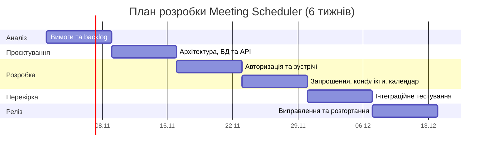

# SDLC: Система обліку зустрічей (Meeting Scheduler)

## 1. Ідея продукту

Meeting Scheduler — вебзастосунок для створення, планування та обліку зустрічей. Користувачі можуть створювати зустрічі, зазначати дату, час, тривалість, місце або онлайн-посилання, запрошувати інших користувачів і відстежувати їхні відповіді. Система допомагає виявляти часові конфлікти та зберігає історію подій.

**Цільова аудиторія:** студенти, викладачі, невеликі робочі команди й організатори навчальних зустрічей.

**Довгострокова ідея:** розширити Meeting Scheduler до освітнього планувальника, який поєднує події, заняття, терміни виконання завдань і часові вікна тестування з інших застосунків.

**Проблема:** узгодження часу в чатах і ручне ведення списків зустрічей спричиняє накладки, втрату інформації та пропущені запрошення. Meeting Scheduler централізує розклад і статуси участі.

**Межі MVP:** реєстрація та вхід, CRUD зустрічей, запрошення, відповіді учасників, перевірка конфліктів, календарний список та історія зустрічей. Автоматичний підбір часу, інтеграції із зовнішніми календарями, електронними щоденниками, Quiz App та повідомлення електронною поштою відкладаються. Вони не входять до Definition of Done першого релізу.

## 2. Обрана методологія

**Методологія: Scrum.**

**Чому саме Scrum:** MVP можна розробляти короткими ітераціями: спочатку автентифікація та модель зустрічей, потім запрошення й перевірка конфліктів, далі календар та історія. Після кожного спринту можна перевіряти сценарії та уточнювати вимоги.

**Чому не інші:**

- **Waterfall:** зміни правил запрошень і перевірки зайнятості після проєктування можуть бути дорогими.
- **Kanban:** зручний для підтримки, але на етапі створення MVP доцільніше мати обмежені в часі спринти з конкретною метою.

## 3. Фази життєвого циклу

### 3.1. Requirements (Вимоги)

| | Опис |
|---|---|
| **Вхідні артефакти** | Ідея продукту, цільова аудиторія, проблеми планування зустрічей. |
| **Дії** | Формування user stories, пріоритетів MoSCoW, правил доступу, часових конфліктів і меж MVP. |
| **Вихідні артефакти** | Вимоги в SDD, список завдань, сценарії користувачів. |
| **Критерії виходу** | Узгоджені ролі, 4 основні Must-історії, вимоги не суперечать одна одній. |

### 3.2. Design (Проєктування)

| | Опис |
|---|---|
| **Вхідні артефакти** | Функціональні та нефункціональні вимоги. |
| **Дії** | Вибір модульного моноліту, проєктування PostgreSQL, ER-діаграми, архітектури, API та UML-сценаріїв. |
| **Вихідні артефакти** | SDD, схема даних, діаграми та ескіз API. |
| **Критерії виходу** | Описано створення зустрічі та відповідь на запрошення, перевірку конфліктів і права доступу. |

### 3.3. Implementation (Розробка)

| | Опис |
|---|---|
| **Вхідні артефакти** | SDD, модель даних, API та backlog. |
| **Дії** | Реалізація реєстрації, CRUD зустрічей, запрошень, RSVP, перевірки зайнятості, календаря та історії; написання тестів. |
| **Вихідні артефакти** | Код клієнта й сервера, міграції БД, API, автоматичні тести. |
| **Критерії виходу** | Основні сценарії MVP працюють локально, дані зберігаються в БД, базові тести проходять. |

### 3.4. Testing (Тестування)

| | Опис |
|---|---|
| **Вхідні артефакти** | Реалізований MVP, SDD, тестові дані. |
| **Дії** | Тестування створення/редагування/скасування, RSVP, конфліктів, часових зон, прав доступу, одночасних запитів і браузерів. |
| **Вихідні артефакти** | Звіти тестування, перелік дефектів, виправлений код. |
| **Критерії виходу** | Критичних помилок немає, чужі зустрічі не змінюються, накладки виявляються, основні сценарії проходять. |

### 3.5. Deployment (Розгортання)

| | Опис |
|---|---|
| **Вхідні артефакти** | Протестований MVP, конфігурація та міграції БД. |
| **Дії** | Налаштування сервера, змінних середовища, PostgreSQL, HTTPS, запуск міграцій і smoke-тестів. |
| **Вихідні артефакти** | Розгорнутий застосунок, інструкція запуску. |
| **Критерії виходу** | Можна увійти, створити зустріч, відповісти на запрошення й побачити зміни в календарі. |

### 3.6. Maintenance (Підтримка)

| | Опис |
|---|---|
| **Вхідні артефакти** | Розгорнута система, відгуки, логи й результати тестів. |
| **Дії** | Виправлення дефектів, оновлення залежностей, резервне копіювання, аналіз зручності та планування покращень. |
| **Вихідні артефакти** | Нові версії, оновлена документація та backlog. |
| **Критерії виходу** | Помилки відстежуються, зміни перевіряються до релізу, документація актуальна. |

## 4. Definition of Done для продукту

- [ ] Користувач може зареєструватися, увійти й вийти з системи.
- [ ] Авторизований користувач може створити зустріч із назвою, датою, часом і тривалістю.
- [ ] Організатор може змінити або скасувати лише власну зустріч.
- [ ] Можна запросити зареєстрованих користувачів; вони можуть прийняти або відхилити запрошення.
- [ ] Система виявляє часові перетини для організатора та запрошених і попереджає про них.
- [ ] Користувач бачить свої майбутні та минулі зустрічі.
- [ ] Час зберігається однозначно, з урахуванням часових зон.
- [ ] API перевіряє автентифікацію, права доступу та вхідні дані.
- [ ] Основні сценарії покриті тестами; критичних дефектів немає.
- [ ] README.md, SDLC.md і SDD.md відповідають реалізованому стану системи.

## 5. Таймлайн

Орієнтовний план — шість тижнів до першого релізу MVP. Автоматичні тести створюються паралельно з реалізацією.

## 6. Ролі та комунікація

### Команда

| Роль | Зона відповідальності |
|---|---|
| Розробник (я) | Аналіз вимог, архітектура, фронтенд, бекенд, база даних і розгортання. |
| Тестувальник (я) | Перевірка сценаріїв, автоматизовані тести та виправлення дефектів. |
| Користувачі для зворотного зв'язку | Оцінювання зручності створення зустрічей, запрошень і календаря. |

Проєкт виконується самостійно як навчальна робота; ролі Scrum адаптовані до одного розробника.

### Комунікація

- **Планування:** на початку кожного спринту визначаються пріоритети та критерії приймання.
- **Контроль прогресу:** наприкінці спринту перевіряється працездатний результат.
- **Завдання й дефекти:** фіксуються у GitHub Issues або проєктному backlog.
- **Код і документація:** зберігаються в GitHub; рішення оновлюються в `SDD.md` та `SDLC.md`.

## 7. План розвитку після MVP: інтеграції

Інтеграції — **окремі майбутні ітерації Scrum**, а не частина шеститижневого таймлайну першого релізу. Кожна інтеграція потребує узгодження API зовнішньої системи, прав доступу та тестування.

| Етап | Напрям | Основні завдання | Критерії приймання |
|---|---|---|---|
| Після MVP — 1 | Універсальні навчальні події | Тип події (`meeting`, `lesson`, `exam`, `deadline`, `quiz`), фільтри, посилання на зовнішній ресурс | Події різних типів відображаються в календарі без зміни базової логіки зустрічей |
| Після MVP — 2 | **Quiz App** | Прив'язка тесту до події, параметри відкриття/закриття, авторизована синхронізація, обробка збоїв | Тест доступний лише у визначене Quiz App вікно; дубльовані повідомлення не створюють дублікати |
| Після MVP — 3 | **Електронний щоденник / журнал** | Імпорт занять і дедлайнів, мапінг студентів і груп, налаштування дозволів; опційно оцінки | У календарі коректні події; оцінки передаються лише за належними правами |
| Після MVP — 4 | **Відеозустрічі та зовнішні календарі** | OAuth-підключення Google Calendar/Meet та Zoom; створення, перенесення й скасування конференцій; опційно Teams/Outlook; нагадування, інкрементальна синхронізація | Після підтвердження провайдера учасники отримують коректне посилання; збої позначаються як не синхронізовані; відкликання доступу зупиняє подальший обмін |
| Після MVP — 5 | Аналітика планування | Нагадування, зведення завантаженості, доступні часові слоти | Користувач може керувати сповіщеннями; приватні події не розкриваються |

### Додаткові дії за фазами SDLC

- **Requirements:** погодити власника даних кожної системи, правила дедлайнів і часових обмежень тестів, згоду на синхронізацію, потоки даних між студентом і викладачем; визначити сценарії відеозустрічей (навчальні, особисті, бізнес), правила запрошення зовнішніх гостей та потреби в нагадуваннях.
- **Design:** спроєктувати адаптери інтеграцій, захищене зіставлення зовнішніх ID, схему подій і обробку вебхуків; задокументувати поведінку при втраті зв'язку, розділення `join_url` та прав організатора, обробку часового поясу й скасування конференцій.
- **Implementation:** реалізувати інтеграційні контракти і налаштування підключень окремо від ядра Meeting Scheduler; спочатку створення конференції Google Meet / Zoom, потім синхронізацію перенесень, скасувань і повторних подій.
- **Testing:** перевірити граничні моменти відкриття/закриття тесту, часові зони й літній час, повторні вебхуки, прострочені токени, скасування події та відсутність доступу; для відеозустрічей — створення без дублювань, захист посилань організатора, відсутність доступу до чужих конференцій та резервний режим із ручним посиланням.
- **Deployment / Maintenance:** безпечне зберігання секретів, моніторинг черг синхронізації, керовані повторні спроби, оновлення API-контрактів.

**Принцип поділу відповідальності:** Meeting Scheduler зберігає часову подію та відображає план; **Quiz App** перевіряє права на проходження та фактично блокує доступ за часом; **електронний щоденник** є джерелом навчального розкладу та, за наявності прав, журналу оцінок. Такий поділ знижує ризик неузгодженості даних.

### Окрема ітерація: онлайн-зустрічі для навчання, особистих справ і бізнесу

Запропонований порядок впровадження **після MVP**, без включення до основного шеститижневого плану:

1. **Проєктування:** вибір провайдера (`google_meet`, `zoom`, опційно `teams`), правила ручних посилань, структура підключеного акаунта, перевірка прав організатора.
2. **Базова інтеграція:** підключення провайдера за OAuth, створення онлайн-зустрічі від імені авторизованого організатора, повернення посилання учасника і `external_meeting_id`.
3. **Синхронізація:** оновлення дати/часу, скасування, повторні спроби при тимчасовій помилці, захист від дублювання, журнал статусів і ручний резервний режим.
4. **Приймальні тести:** перевірити сценарії «онлайн-консультація», «особиста розмова» й «бізнес-нарада», коректність часових зон, права доступу, поведінку після відкликання OAuth та повторного надсилання запитів.

**Definition of Done для цієї ітерації:** організатор із підключеним обліковим записом може створити конференцію та поділитися **посиланням учасника**; зміни календаря або відображаються в зовнішньому сервісі, або мають зрозумілий статус помилки; секрети й організаторські URL не розкриваються; функція перевірена інтеграційними тестами на тестових акаунтах.
